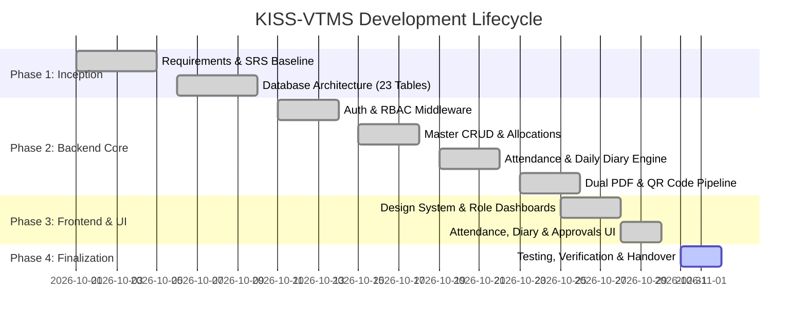

# Project Management Plan
## KISS Vocational Training Management System (KISS-VTMS)

---

## 1. Work Breakdown Structure (WBS)
```
1.0 KISS-VTMS Project Initiation & Architecture
    1.1 Requirements Analysis & Stakeholder Mapping
    1.2 Software Requirements Specification (SRS)
    1.3 Relational Database Schema Design (23 Tables)
    1.4 Architecture Baseline & Security Specifications
2.0 Backend Core Engineering (Node.js / Express)
    2.1 Database Drivers & Migration Scripts (MySQL & SQLite)
    2.2 Authentication Engine (JWT, bcrypt, RBAC Middleware)
    2.3 Trainee, Trainer, Mentor & Trade Master Modules
    2.4 Programme & Batch Scheduling Engine
    2.5 Attendance Tracking & Calculation Services
    2.6 Chronological Daily Training Diary & Auditing Engine
    2.7 Assessment, Grading & Mentorship Feedback Services
    2.8 8-Point Certificate Eligibility Gatekeeper
    2.9 Dual PDF Document Rendering Pipeline (Cert 1 & Cert 2)
    2.10 Zero-PII QR Code Verification Portal
3.0 Frontend Engineering (React / Tailwind CSS / Recharts)
    3.1 Design System Baseline (Navy Blue, Gold Accents, Accessible SaaS)
    3.2 Authentication & Session Flow (Login, Role Redirection)
    3.3 6 Role-Specific Operational Dashboards
    3.4 Trainee Registration, Profile & Journey Timeline
    3.5 Programme, Batch, Trade & Allocation Management UI
    3.6 Attendance Marking & Low-Attendance Alert Interfaces
    3.7 Day-wise Chronological Training Diary UI
    3.8 Assessment Submission & Mentorship Tracking UI
    3.9 Certificate Eligibility Checklist & Approval Workspace
    3.10 In-Browser PDF Preview, Download & Verification Scanner
4.0 Verification, Quality Assurance & Deployment
    4.1 Unit, Integration & Security Test Execution
    4.2 Institutional User Acceptance Testing (UAT)
    4.3 Production Deployment & Database Seeding
    4.4 Maintenance, Backup Protocols & Administrator Handover
```

---

## 2. Project Timeline & Milestones



### Key Milestones
- **M1 (Oct 10, 2026)**: Formal SRS and 23-Table Relational Schema Approved.
- **M2 (Oct 18, 2026)**: Backend REST API Core & Role-Based Permissions Completed.
- **M3 (Oct 26, 2026)**: Daily Training Diary & Dual PDF Generation Engine Operational.
- **M4 (Oct 30, 2026)**: Full-Stack React Client with 6 Role Dashboards Integrated.
- **M5 (Oct 31, 2026)**: End-to-End System Integration, Testing & Documentation Signed-off.

---

## 3. Risk Analysis and Mitigation Matrix

| Risk ID | Risk Description | Severity | Likelihood | Mitigation Strategy |
| :--- | :--- | :--- | :--- | :--- |
| **RSK-01** | Student PII exposed during public QR certificate verification | Critical | Low | Public verification API strictly filters response payload to 4 non-sensitive fields (Name, Programme, Date, Validity). |
| **RSK-02** | Premature issuance of certificates to unqualified trainees | High | Low | Automated 8-point eligibility gate blocks certificate approval if attendance < 75% or assessments < 50%. |
| **RSK-03** | Faculty duplicate attendance submissions on busy days | Medium | Medium | Unique database composite constraint on `(batch_id, trainee_id, session_date, session_number)`. |
| **RSK-04** | Missing or irregular daily training diary records | Medium | Medium | Coordinator dashboard provides automated alerts for batches with unrecorded training days. |
| **RSK-05** | High PDF generation load during batch graduation ceremonies | Medium | Low | Streaming vector PDF generation with low memory overhead, asynchronous generation queue. |

---

## 4. Maintenance and Support Plan
- **Backup Strategy**: Nightly automated database dumps and PDF storage snapshot synchronization.
- **Security Patches**: Monthly dependency vulnerability scanning (`npm audit`) and Node.js LTS maintenance.
- **Data Archiving**: Graduated cohort records marked as archived after 3 academic cycles while remaining verifiable.
- **Support Escalation**:
  - Tier 1: Training Coordinator for login resets and batch configuration.
  - Tier 2: Super Administrator for user role escalation and system settings.
  - Tier 3: Core Engineering team for software updates and infrastructure.
