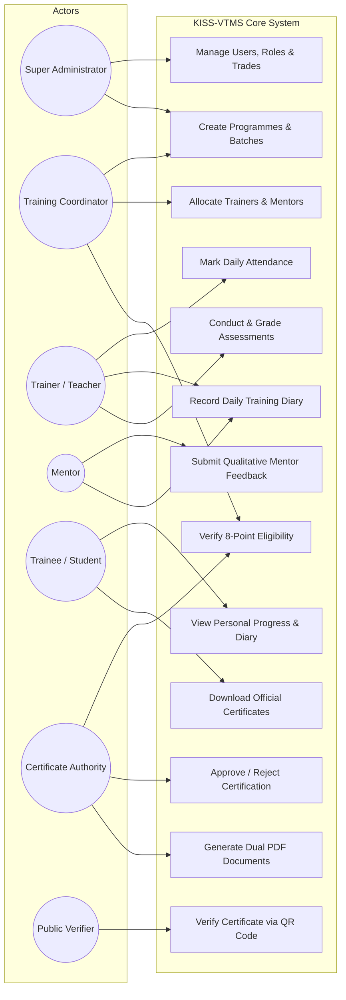
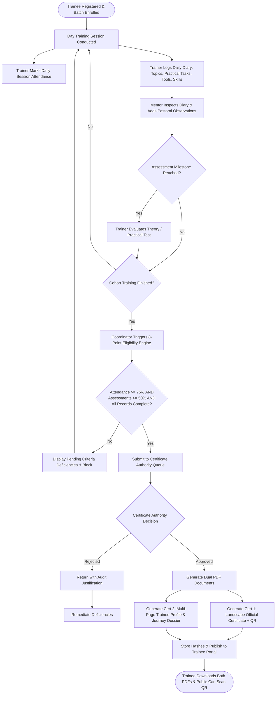
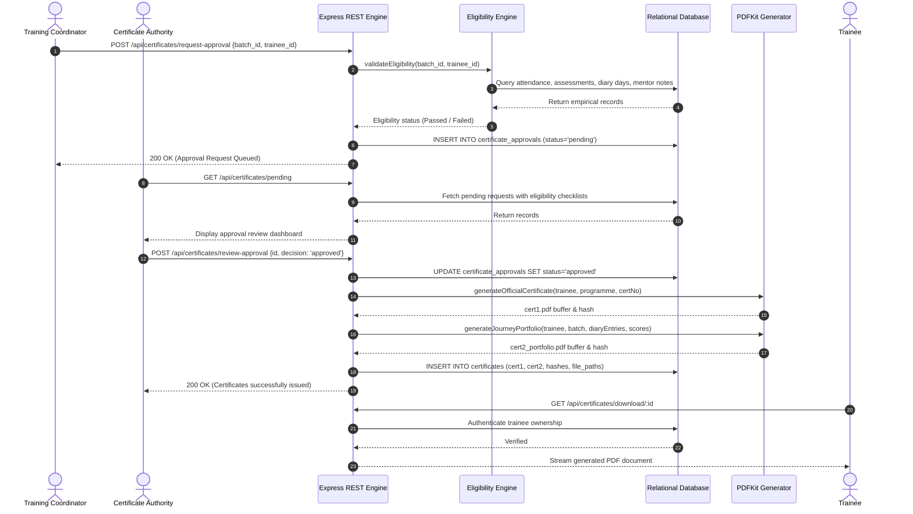
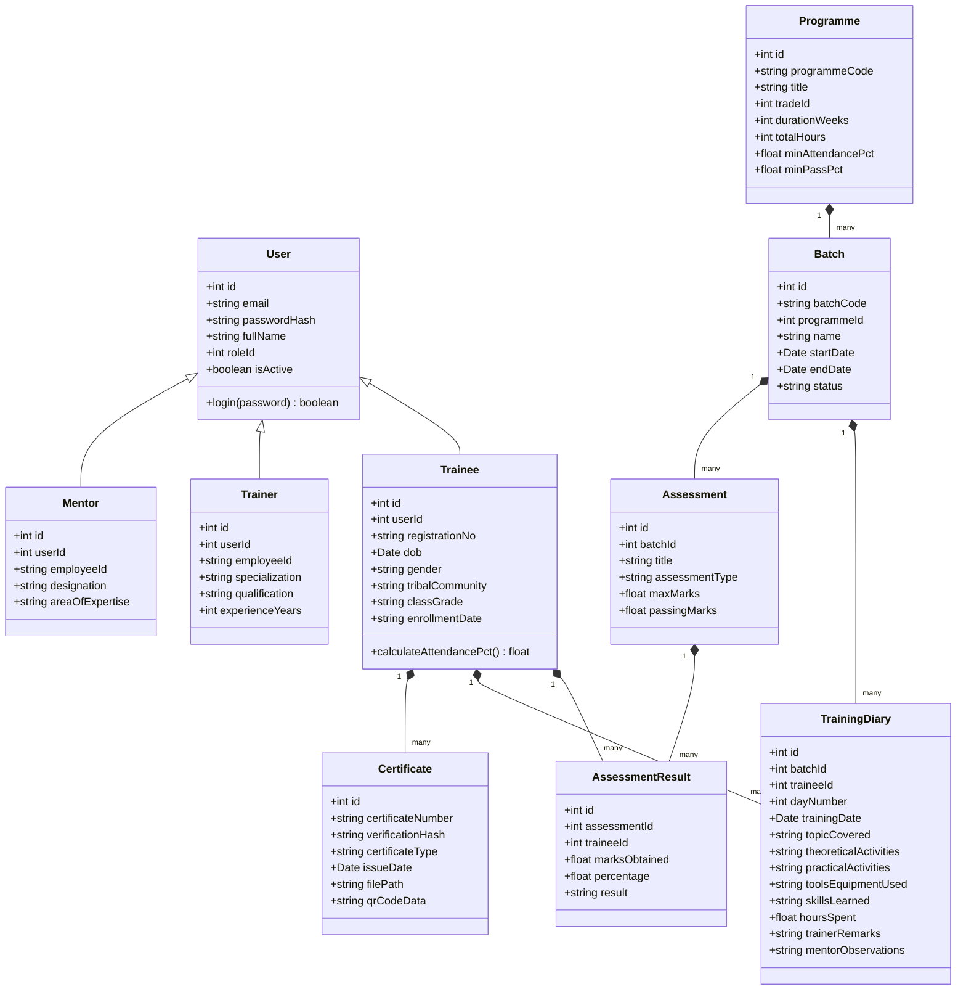
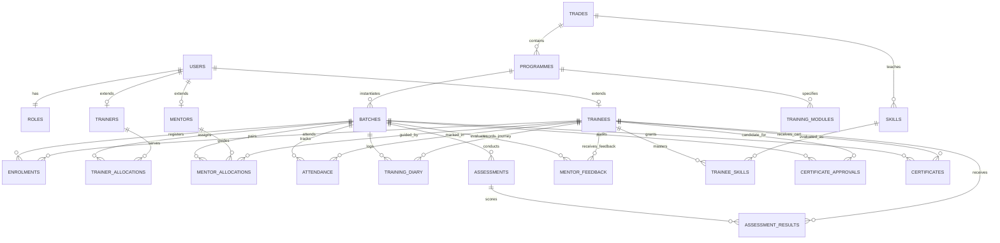
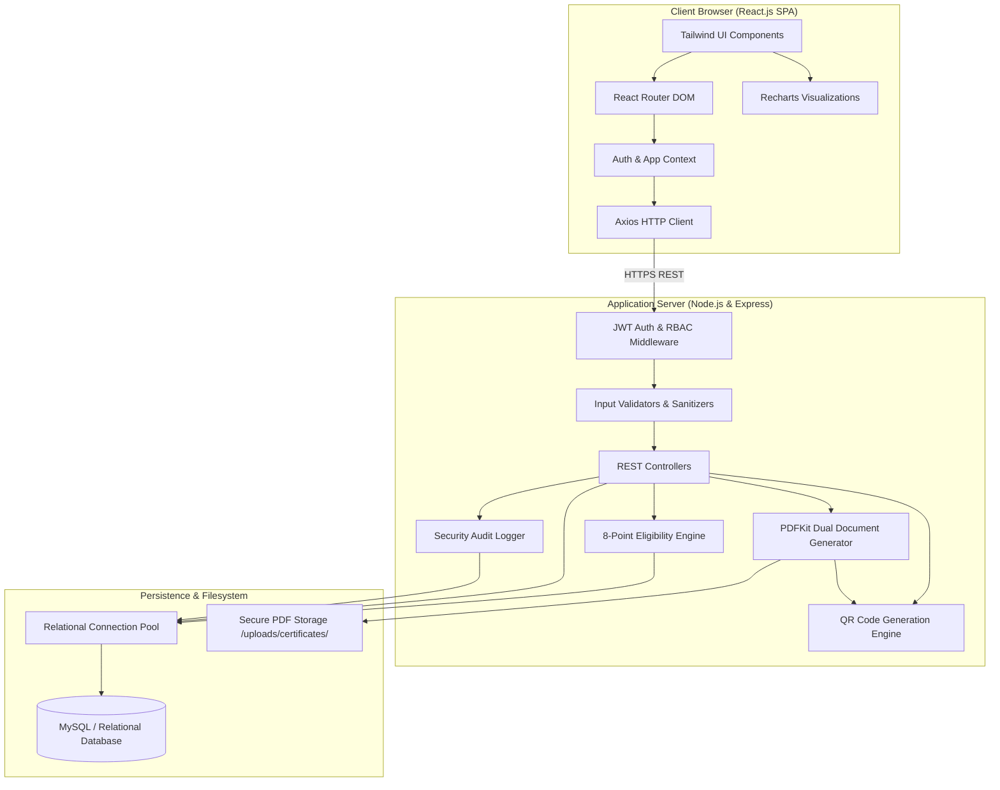
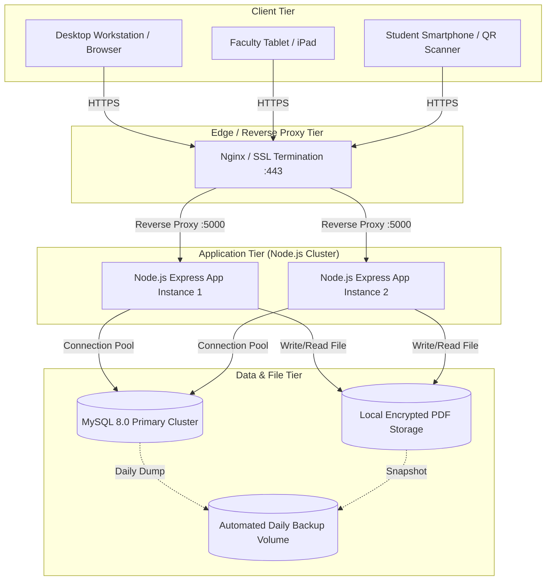

# UML Diagrams for KISS-VTMS
**Application:** KISS Vocational Training Management System (KISS-VTMS)  
**Format:** Editable Mermaid Markdown  

---

## 1. Use Case Diagram

---

## 2. Activity Diagram: Daily Training & Certification Lifecycle

---

## 3. Sequence Diagram: Dual Certificate Issuance Workflow

---

## 4. Class Diagram

---

## 5. Entity-Relationship (ER) Diagram

---

## 6. Component Diagram

---

## 7. Deployment Diagram

